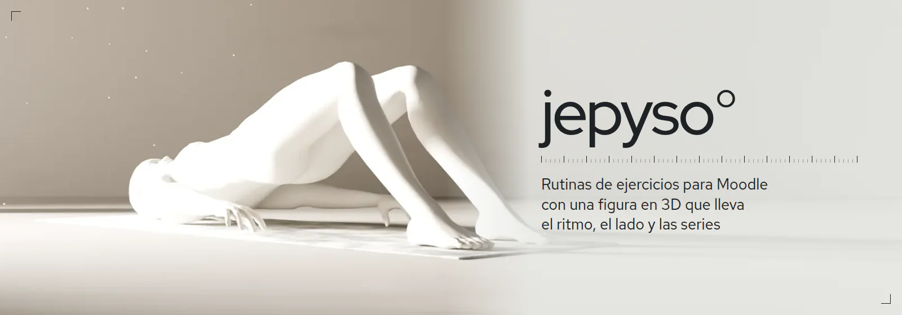
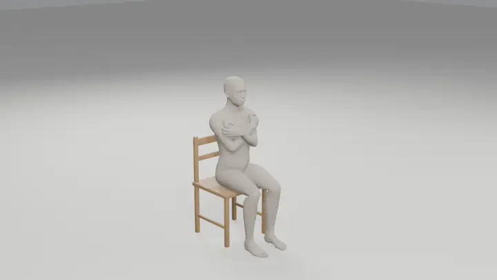
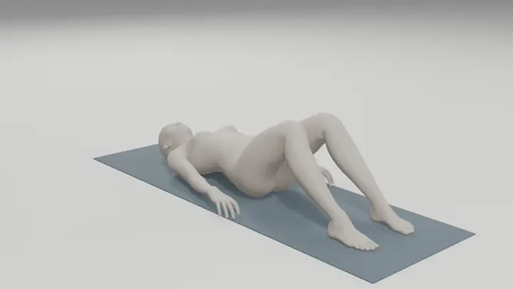
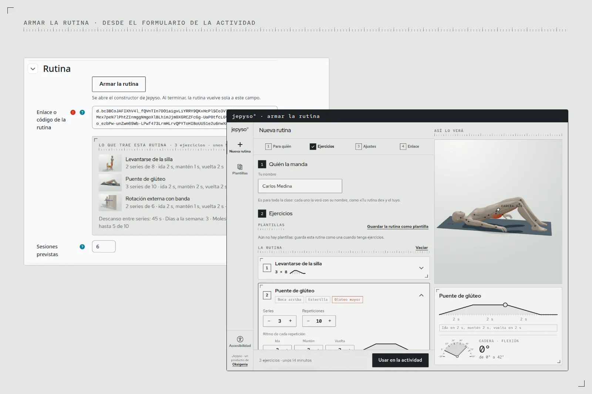
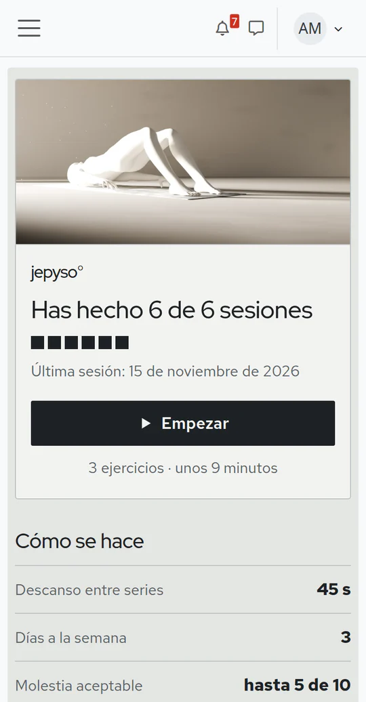
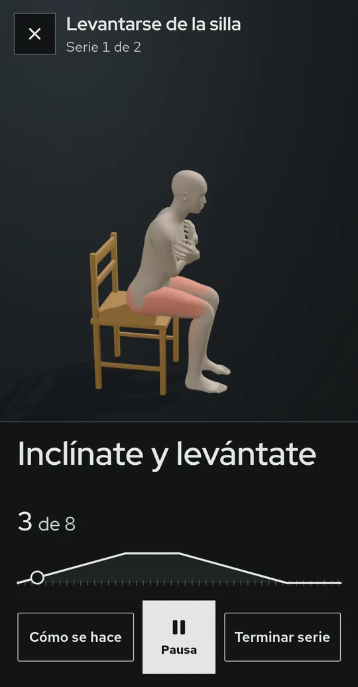
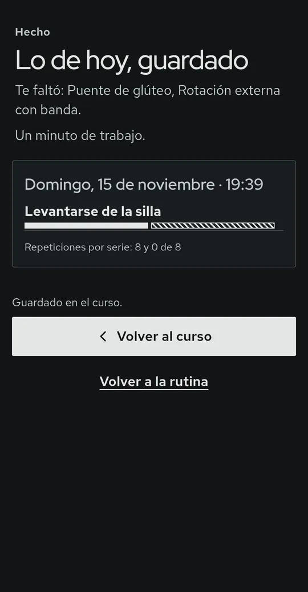
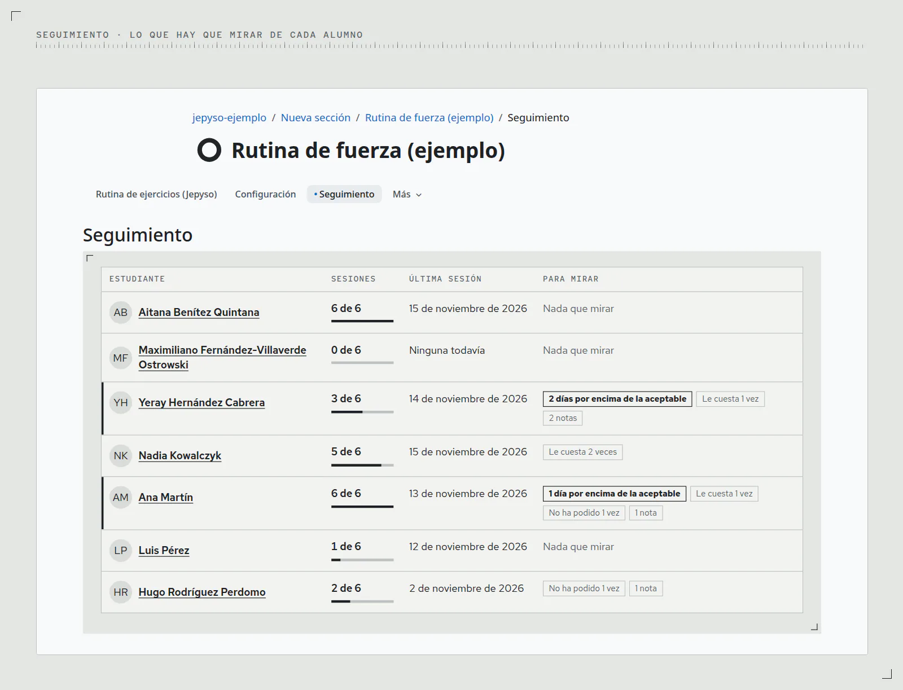
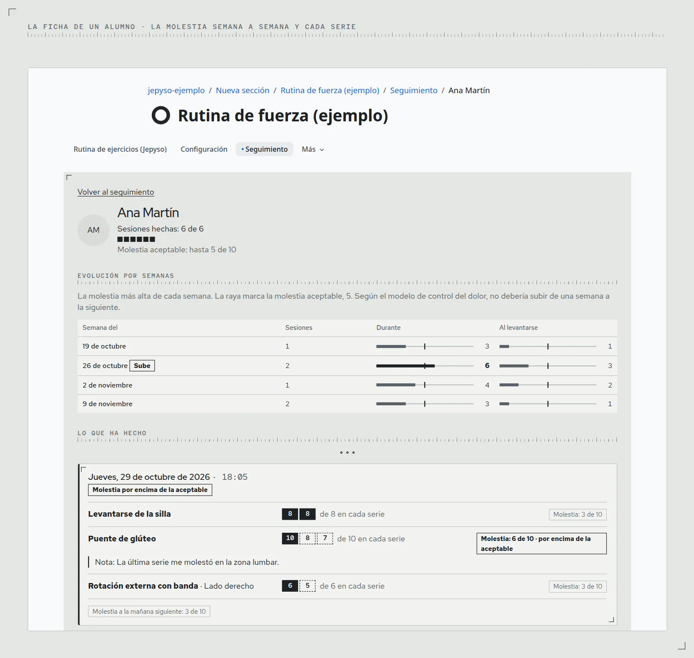
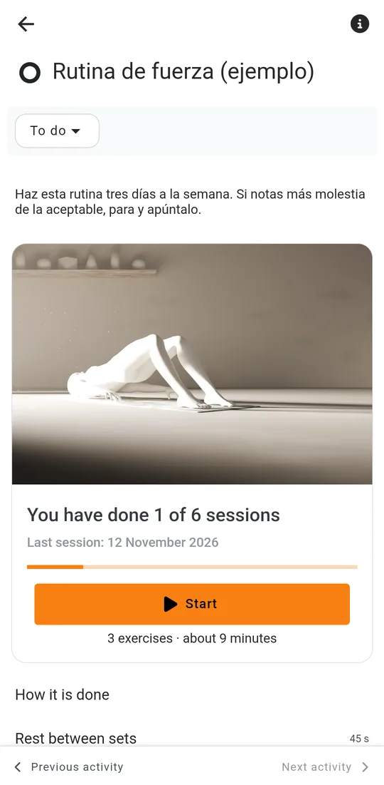

  <picture>
    <source media="(prefers-color-scheme: dark)" srcset=".github/readme/cabecera-es-oscuro.webp">
    
  </picture>

  <a href="README.md">Read in English</a> · <a href="https://jepyso.com">jepyso.com</a> · Moodle 4.5 a 5.3 ·
  GNU GPL v3

# Rutina de ejercicios (Oksigenia Jepyso)

Una actividad para Moodle. El docente pone una rutina de ejercicios en el curso y cada estudiante la hace en el
teléfono o en el ordenador, siguiendo a una figura en 3D que se mueve al ritmo, del lado y con las series que dice la
rutina. Al acabar, apunta las repeticiones que hizo y la molestia que notó. Cada sesión se guarda en Moodle, cuenta
para la finalización y la calificación, y el docente sigue a cada estudiante semana a semana.

Está hecha para cualquier centro educativo o de formación: clases de Educación Física y escuelas que forman a
fisioterapeutas, entrenadores o profesionales de las ciencias del deporte.

<table>
  <tr>
    <td width="50%"></td>
    <td width="50%"></td>
  </tr>
  <tr>
    <td align="center">Levantarse de la silla, con la primera figura</td>
    <td align="center">Puente de glúteo, con la segunda figura</td>
  </tr>
</table>

## Cómo funciona

### 1. El docente arma la rutina

En los ajustes de la actividad, «Armar la rutina» abre el constructor de Jepyso: los ejercicios con sus series,
repeticiones, ritmo y lado, el descanso entre series o las vueltas de un circuito, los días a la semana y la molestia aceptable. Cuando está lista,
la rutina vuelve sola al formulario. También se puede pegar una rutina hecha en
[app.jepyso.com](https://app.jepyso.com), con su enlace o su código.

<picture>
  <source media="(prefers-color-scheme: dark)" srcset=".github/readme/formulario-es-oscuro.webp">
  
</picture>

### 2. Cada estudiante sigue a la figura

La página de la actividad enseña la rutina y lo que lleva hecho cada estudiante. «Empezar» abre el reproductor: la
figura sube, mantiene y baja al ritmo de cada ejercicio, del lado que toca, serie tras serie, con un sonido y una
vibración en cada repetición. Al final, el estudiante apunta lo que hizo, la molestia, si un ejercicio le costó o no
pudo hacerlo, y una nota.

  <picture>
    <source media="(prefers-color-scheme: dark)" srcset=".github/readme/alumno-es-oscuro.webp">
    
  </picture>
  &nbsp;
  
  &nbsp;
  

### 3. Cada sesión llega al curso

Cada sesión se guarda en Moodle en cuanto termina; sin conexión espera en el teléfono y se manda en cuanto la hay. El
docente ve quién ha hecho qué y lo que hay que mirar: días por encima de la molestia aceptable, ejercicios que costaron
o no se pudieron hacer, notas. La ficha de cada estudiante enseña la molestia semana a semana frente a la aceptable, y
cada serie hecha frente a la pedida.

<picture>
  <source media="(prefers-color-scheme: dark)" srcset=".github/readme/seguimiento-es-oscuro.webp">
  
</picture>

<picture>
  <source media="(prefers-color-scheme: dark)" srcset=".github/readme/ficha-es-oscuro.webp">
  
</picture>

## En la app de Moodle

La actividad funciona en la app oficial de Moodle sin configurar nada. Su página enseña la rutina y el progreso;
«Empezar» abre el reproductor dentro de la app, con la sesión ya iniciada, y el progreso se pone al día en cuanto se
cierra el reproductor. Probada en Android con la app oficial 5.2.

  

## Lo que trae

- **La figura cumple la pauta:** su ritmo (sube, mantén, baja), su lado, sus series y su descanso. Nunca un vídeo fijo
  que va a otro ritmo.
- **La molestia, con método:** cada rutina tiene un nivel aceptable (5 de 10 si el docente no pone otro), según el
  modelo de control del dolor (Thomeé, 1997). Los días que lo pasan salen marcados, y la mañana siguiente a una sesión
  se le pregunta al estudiante cómo notaba la zona al levantarse.
- **Finalización y calificación:** la regla «Hacer las sesiones previstas»; con una calificación en puntos, la nota
  sigue la parte de las sesiones hechas, y el docente siempre puede calificar a mano.
- **Grupos**, separados y visibles; **copia de seguridad y restauración** con las sesiones; **reinicio del curso**;
  **API de privacidad**.
- **El docente prueba la rutina** como la vería un estudiante, y nada de lo que hace se guarda.
- **Su propio aspecto**, con cualquier tema, en claro y en oscuro.
- **Nada sale de tu sitio:** ningún servicio externo ni seguimiento; el reproductor lo sirve el propio Moodle.

## Los ejercicios

El plugin trae doce ejercicios para todo el cuerpo, en las dos figuras: levantarse de la silla,
puente de glúteo, rotación externa con banda, media sentadilla, elevación de talones, equilibrio a una pierna, plancha
de rodillas, brazo y pierna contrarios a cuatro patas, gato-camello, almeja, extensión de rodilla sentado y rodilla al
pecho. Si una rutina lleva ejercicios que el sitio no tiene, el docente ve cuáles.

## Idiomas

Las páginas de la actividad están en español y en inglés, y el reproductor también, con sus ejercicios y su voz
grabada: sigue el idioma de cada usuario en Moodle, y el estudiante puede cambiarlo dentro del reproductor. Llegarán
más idiomas.

## Requisitos

- Moodle 4.5 a 5.3, con su PHP de siempre.
- Nada más: ningún servicio externo ni paso de compilación.

## Instalación

1. Copia el plugin en `mod/oksigeniajepyso` (desde Moodle 5.1, `public/mod/oksigeniajepyso`) o instala el ZIP desde
   *Administración del sitio > Extensiones > Instalar complementos*.
2. Entra en *Administración del sitio > Notificaciones* o ejecuta `admin/cli/upgrade.php`.
3. Añade una «Rutina de ejercicios (Jepyso)» a un curso.

## Privacidad

Las sesiones se guardan en el sitio (`oksigeniajepyso_session`): el día y la hora, lo hecho en cada serie, la molestia,
las marcas «me ha costado» y «no he podido» y las notas. Están declaradas en la API de privacidad, que las exporta y
las borra; la copia de seguridad y la restauración las llevan con los datos de usuario, y el reinicio del curso puede
borrarlas.

## Para quien desarrolla

- El reproductor de `reproductor/` es la app web de Jepyso con solo lo que usa un curso, construida desde su
  repositorio con `tools/construir-moodle.sh <esta carpeta>`, que escribe también `templates/player.mustache`. No se
  cambian aquí.
- Sus páginas son `player.php` y `builder.php`. Lee y guarda las sesiones con las funciones externas
  `mod_oksigeniajepyso_get_sessions` y `mod_oksigeniajepyso_save_sessions`.
- El guion del formulario de la actividad está en `amd/src/form.js`; tras un cambio, `grunt amd`.
- PHPUnit cubre las rutinas, las sesiones, los servicios web, la finalización, las calificaciones, la privacidad, la
  copia de seguridad, la página en la app y que el reproductor no sale del sitio.

## Licencia

GNU GPL v3 o posterior (`LICENSE`). Copyright 2026 Oksigenia SL. El reproductor es la app web de Jepyso
([OksigeniaSL/jepyso](https://github.com/OksigeniaSL/jepyso)), GPL v3 o posterior, con three.js (MIT) y las fuentes
Red Hat (OFL). Su contenido (las dos figuras y los doce ejercicios, las cabeceras de yeso, el icono, el
mapa del cuerpo y la voz grabada) va con CC BY-SA 4.0, en `reproductor/modelos/LICENSE.md`, con las fichas de las que
salen los movimientos en `reproductor/modelos/fichas/`.

---

Oksigenia Jepyso es de <a href="https://oksigenia.com">Oksigenia</a>.

