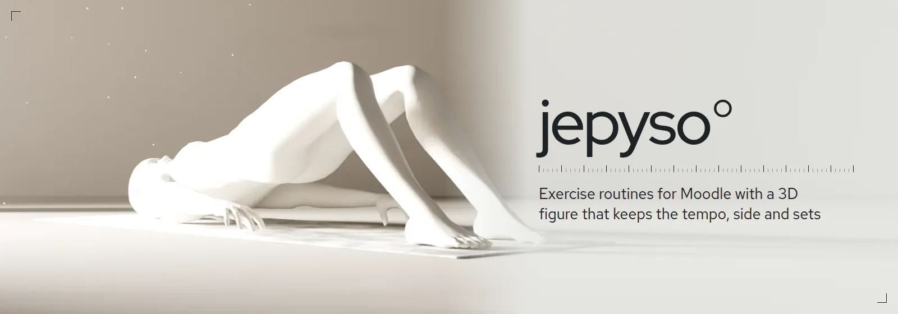
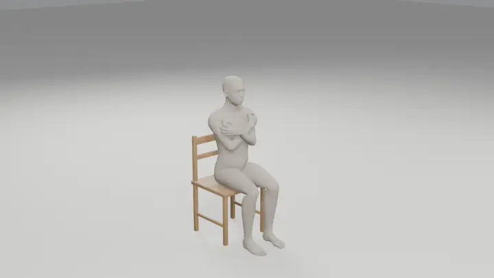
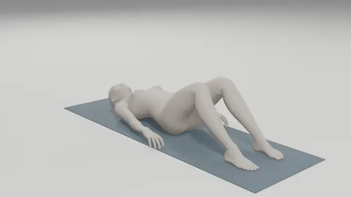
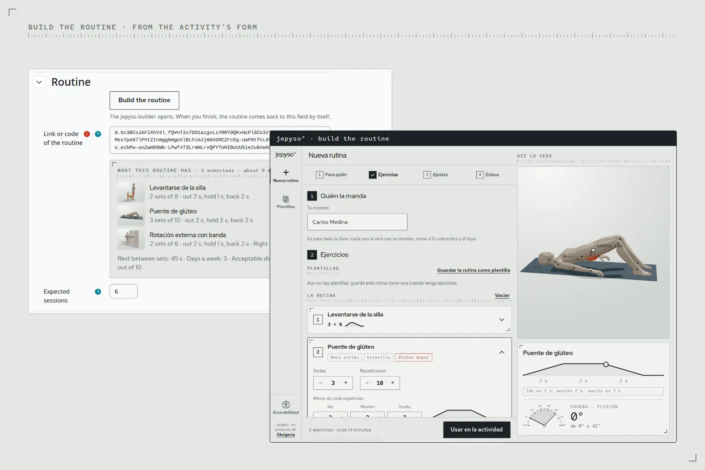
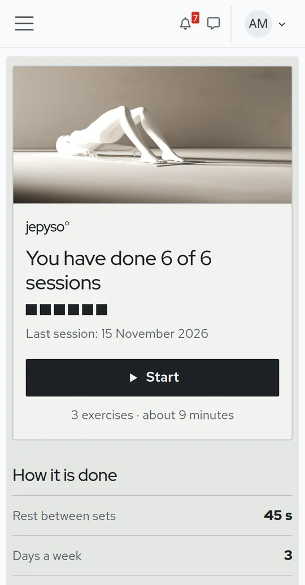
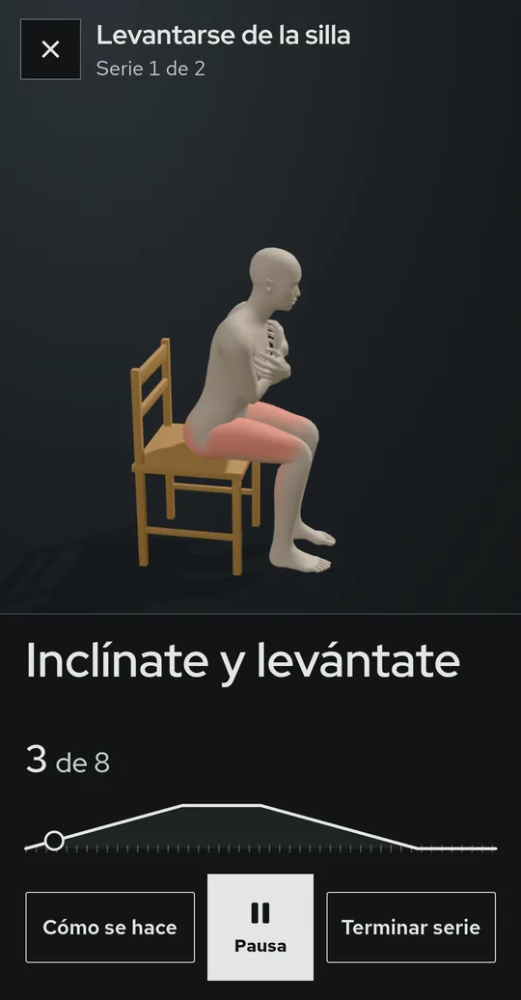
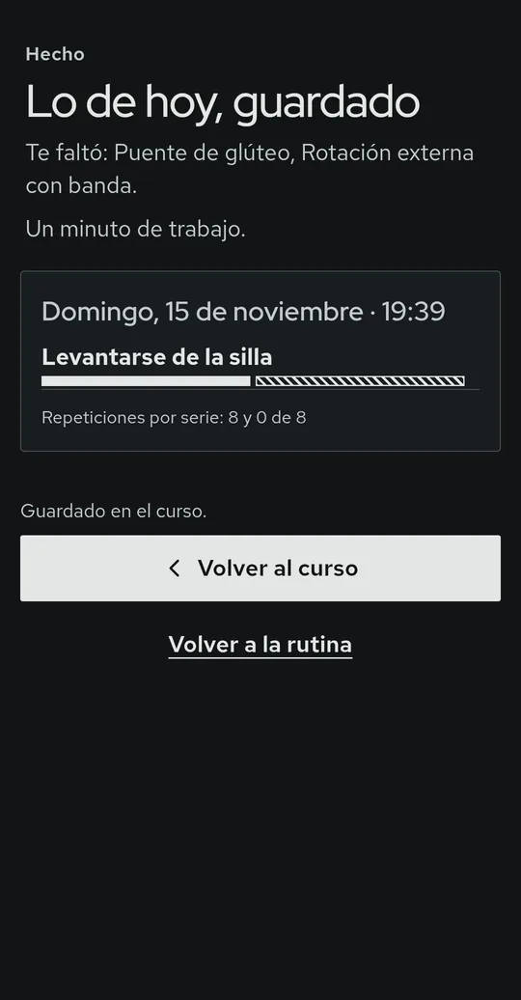
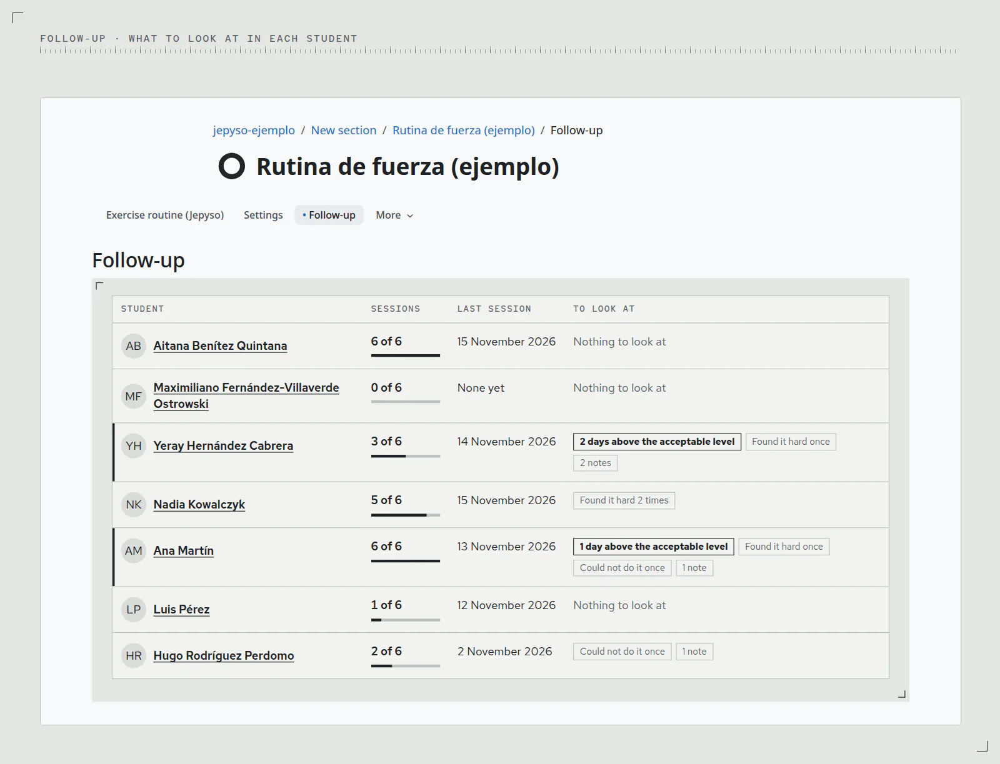
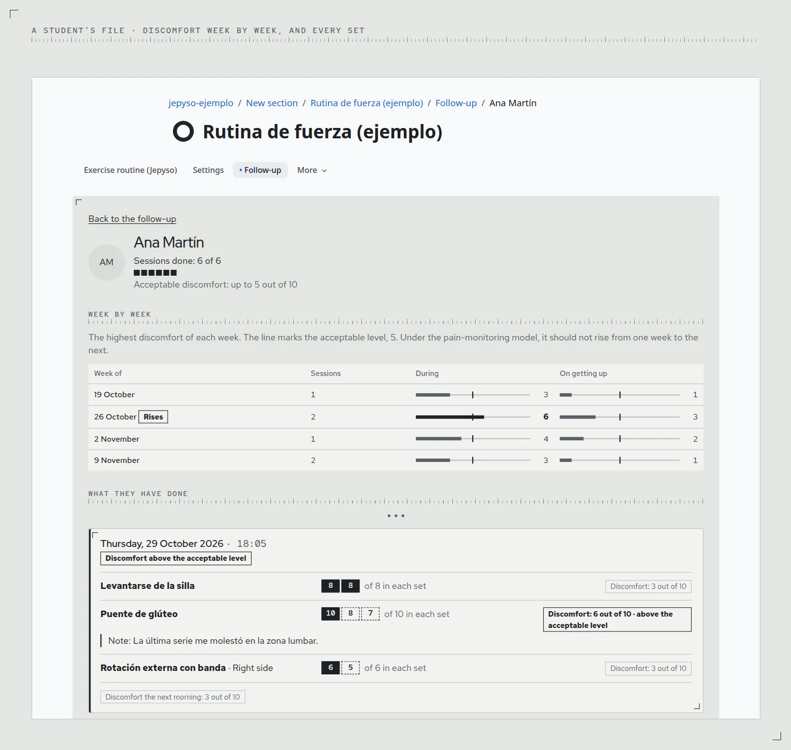
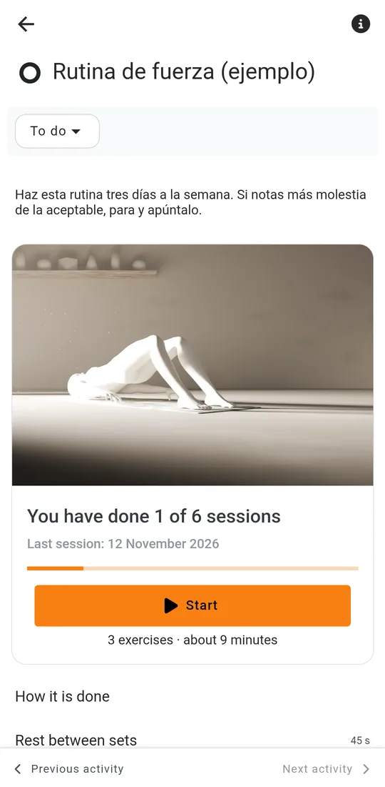

  <picture>
    <source media="(prefers-color-scheme: dark)" srcset=".github/readme/cabecera-en-oscuro.webp">
    
  </picture>

  <a href="README.es.md">Leer en español</a> · <a href="https://jepyso.com">jepyso.com</a> · Moodle 4.5 to 5.3 ·
  GNU GPL v3

# Exercise routine (Oksigenia Jepyso)

An activity for Moodle. The teacher sets an exercise routine as part of the course, and each student does it on a
phone or a computer, following a 3D figure that moves at the tempo, on the side and for the sets the routine says.
Afterwards the student notes down the repetitions done and the discomfort felt. Every session is saved in Moodle,
counts towards completion and grade, and the teacher follows each student week by week.

It is made for any school or training centre: physical education classes, and schools that train physiotherapists,
coaches or sports scientists.

<table>
  <tr>
    <td width="50%"></td>
    <td width="50%"></td>
  </tr>
  <tr>
    <td align="center">Sit to stand, with the first figure</td>
    <td align="center">Glute bridge, with the second figure</td>
  </tr>
</table>

## How it works

### 1. The teacher builds the routine

In the settings of the activity, “Build the routine” opens the builder of Jepyso: the exercises with their sets,
repetitions, tempo and side, the rest between sets or the rounds of a circuit, the days a week and the acceptable
discomfort. When it is ready, the routine comes back to the form by itself. A routine made at [app.jepyso.com](https://app.jepyso.com) can be pasted
too, as a link or as its code.

<picture>
  <source media="(prefers-color-scheme: dark)" srcset=".github/readme/formulario-en-oscuro.webp">
  
</picture>

### 2. Each student follows the figure

The page of the activity shows the routine and how far each student has got. “Start” opens the player: the figure goes
up, holds and comes down at the pace of each exercise, on the right side, set after set, with a sound and a vibration
on every repetition. At the end the student notes down what was done, the discomfort, whether an exercise was hard or
could not be done, and a note.

  <picture>
    <source media="(prefers-color-scheme: dark)" srcset=".github/readme/alumno-en-oscuro.webp">
    
  </picture>
  &nbsp;
  
  &nbsp;
  

### 3. Every session reaches the course

Each session is saved in Moodle as soon as it ends; without a connection it waits on the phone and goes as soon as
there is one. The teacher sees who has done what, and what there is to look at: days above the acceptable discomfort,
exercises found hard or not done, notes. The file of each student shows the discomfort week by week against the
acceptable level, and every set done against the one asked for.

<picture>
  <source media="(prefers-color-scheme: dark)" srcset=".github/readme/seguimiento-en-oscuro.webp">
  
</picture>

<picture>
  <source media="(prefers-color-scheme: dark)" srcset=".github/readme/ficha-en-oscuro.webp">
  
</picture>

## In the Moodle app

The activity works in the official Moodle app with nothing to set up. Its page shows the routine and the progress;
“Start” opens the player inside the app, with the student already signed in, and the progress updates as soon as the
player closes. Tried on Android with the official app 5.2.

  

## What it brings

- **The figure keeps the prescription:** its tempo (up, hold, down), its side, its sets and its rest. Never a fixed
  video at another pace.
- **Discomfort with a method:** each routine has an acceptable level (5 out of 10 unless the teacher sets another),
  after the pain-monitoring model (Thomeé, 1997). The days above it are flagged, and the morning after a session the
  student is asked how the area felt on getting up.
- **Completion and grade:** the rule “Do the expected sessions”; with a grade in points, the grade follows the share
  of sessions done, and the teacher can always grade by hand.
- **Groups**, separate and visible; **backup and restore** with the sessions; **course reset**; **Privacy API**.
- **Teachers try the routine** as a student would, and nothing they do is saved.
- **Its own look** with any theme, in light and in dark.
- **Nothing leaves your site:** no external service and no tracking; the player is served by Moodle itself.

## The exercises

The plugin comes with twelve exercises for the whole body, in both figures: sit to stand, glute
bridge, shoulder external rotation with a band, half squat, heel raises, single-leg balance, knee plank, opposite arm
and leg on all fours, cat-camel, clamshell, seated knee extension and knee to chest. If a routine has exercises the
site does not have, the teacher sees which.

## Languages

The pages of the activity are in English and Spanish. The player, its exercises and its recorded voice too: it follows
each user's language in Moodle, and the student can switch it inside the player. Other languages will follow.

## Requirements

- Moodle 4.5 to 5.3, with its usual PHP.
- Nothing else: no external service and no build step.

## Install

1. Copy the plugin into `mod/oksigeniajepyso` (in Moodle 5.1 and later, `public/mod/oksigeniajepyso`), or install the
   ZIP from *Site administration > Plugins > Install plugins*.
2. Visit *Site administration > Notifications*, or run `admin/cli/upgrade.php`.
3. Add an “Exercise routine (Jepyso)” to a course.

## Privacy

The sessions are kept in the site (`oksigeniajepyso_session`): the day and time, what was done in each set, the
discomfort, the marks “found it hard” and “could not do it”, and the notes. They are declared in the Privacy API,
exported and deleted with it; backup and restore include them with user data, and the course reset can delete them.

## For developers

- The player in `reproductor/` is the web app of Jepyso with only what a course uses, built from its repository with
  `tools/construir-moodle.sh <this folder>`, which also writes `templates/player.mustache`. They are not edited here.
- `player.php` and `builder.php` are its pages. It reads and saves the sessions through the external functions
  `mod_oksigeniajepyso_get_sessions` and `mod_oksigeniajepyso_save_sessions`.
- The script of the activity form is in `amd/src/form.js`; after a change, `grunt amd`.
- PHPUnit covers routines, sessions, web services, completion, grades, privacy, backup, the page in the app, and that
  the player stays in the site.

## Licence

GNU GPL v3 or later (`LICENSE`). Copyright 2026 Oksigenia SL. The player is the web app of Jepyso
([OksigeniaSL/jepyso](https://github.com/OksigeniaSL/jepyso)), GPL v3 or later, with three.js (MIT) and the Red Hat
fonts (OFL). Its content (the two figures and the twelve exercises, the plaster headers, the icon, the
body map and the recorded voice) is under CC BY-SA 4.0, in `reproductor/modelos/LICENSE.md`, with the sheets the
movements are built from in `reproductor/modelos/fichas/`.

---

Oksigenia Jepyso is made by <a href="https://oksigenia.com">Oksigenia</a>.

